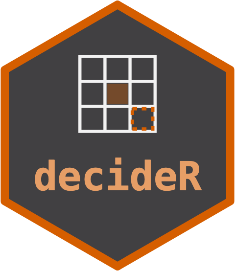

# decideR 

<!-- badges: start -->

[](https://lifecycle.r-lib.org/articles/stages.html#experimental)
[](https://github.com/max578/decideR/actions/workflows/R-CMD-check.yaml)
[](https://app.codecov.io/gh/max578/decideR)
[](https://max578.r-universe.dev/decideR)
[](https://max578.github.io/decideR/)
<!-- badges: end -->

`decideR` is the shared Bayesian decision layer of the ORCHESTRA
analytics framework. It maps a posterior into an action under an
explicit utility and a hard feasibility constraint, returning the action
together with a grounding label and an abstention when the evidence will
not support a decision. The grounding label is combined worst-case
across inputs, so a decision resting on an unverified external fact is
downgraded to abstention -- the Independent Oracle Principle -- rather
than asserted with false confidence.

The same engine sizes a crop nitrogen rate and a trading position,
because both are the same problem: act under uncertainty, and refuse to
act when the evidence will not support it.

As the **tail of an ORCHESTRA pipeline** it decides directly from an
upstream member's `orchestra_manifest` -- a PESTO inversion, a kernR
causal test, a flexyBayes posterior -- via `decide_from_manifest()`,
reading the predictive draws and the producer's grounding token off the
contract without depending on the contract package. Its loss library
includes a **grade-band loss** (`grade_band_value()`) that prices
quality-threshold payoffs -- a grain price that steps up as protein
clears a milling and a premium band -- as a first-class step value
schedule.

## Related packages

- [decisionSupport](https://CRAN.R-project.org/package=decisionSupport)
  chooses between two alternatives by expected welfare from Monte Carlo
  simulation, and uses value-of-information analysis to decide which
  uncertainties are worth reducing.
- [BCEA](https://CRAN.R-project.org/package=BCEA) takes cost and
  effectiveness draws for two or more interventions, for example MCMC
  output from a Bayesian model, and finds the most cost-effective one
  with probabilistic sensitivity analysis.
- [voi](https://CRAN.R-project.org/package=voi) calculates the expected
  value of perfect, partial and sample information from a decision
  model.

decideR also starts from posterior draws, but chooses from a range of
actions (a nitrogen rate, a position size) under an explicit utility and
a hard constraint, can price stepped payoffs such as grain protein
bands, and abstains instead of deciding when an input is not grounded.

## Installation

``` r
pak::pak("max578/decideR")
```

## Example

The two reference decisions, from two domains, both route through the
one engine.

``` r
library(decideR)

# A crop decision: choose the nitrogen rate of greatest expected profit, given
# posterior yield draws at each candidate rate.
rates <- seq(0, 200, by = 25)
ymax  <- rnorm(2000L, 5.5, 0.3)
yield_draws <- vapply(rates,
  function(r) 3 + (ymax - 3) * (1 - exp(-r / 80)) + rnorm(2000L, 0, 0.1),
  numeric(2000L))
decide_input_rate(yield_draws, rates, price_grain = 300, price_input = 1.2,
                  grounding = grounding_grounded())
#> <decision> decided  [grounded]
#>   action : rate=175
#>   E[utility]: 1356
#>   candidates: 9 evaluated (method: expected_profit)

# A trading decision: size a position by drawdown-capped expected log-growth.
# An un-grounded price feed forces flat -- the capital firewall.
returns <- rnorm(5000L, 0.02, 0.03)
decide_position_size(returns, capital = 1000, max_drawdown = 0.15,
                     grounding = grounding_unverified())
#> <decision> ABSTAINED (input_ungrounded)  [ungrounded]
#>   action : flat (0%) [ungrounded]
#>   candidates: 41 evaluated (method: kelly_log_growth_drawdown_capped)

# A quality-graded payoff: protein bands price the decision, not the mean.
protein_value <- grade_band_value(breaks = c(11.5, 13.0),
                                  values = c(300, 360, 420))
protein_value
#> <grade_band_value> 3 bands
#>          band value
#>  [-Inf, 11.5)   300
#>    [11.5, 13)   360
#>     [13, Inf)   420
```

See `vignette("getting-started")` for the full walk-through, including
the manifest-native pipeline tail and the grade-band loss worked end to
end.

## Contributing

Bug reports and suggestions are welcome through the [issue
tracker](https://github.com/max578/decideR/issues).

## Citation

``` r
citation("decideR")
```

## License

This package is released under: MIT + file LICENSE.
